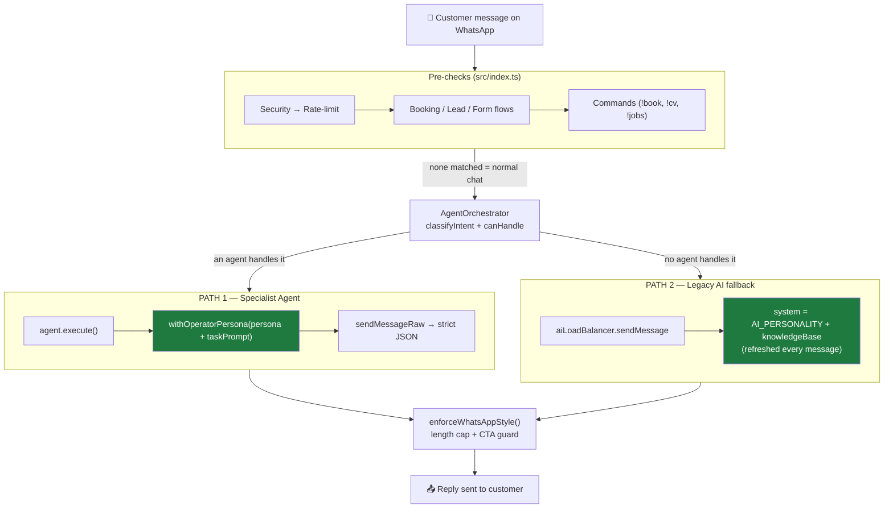
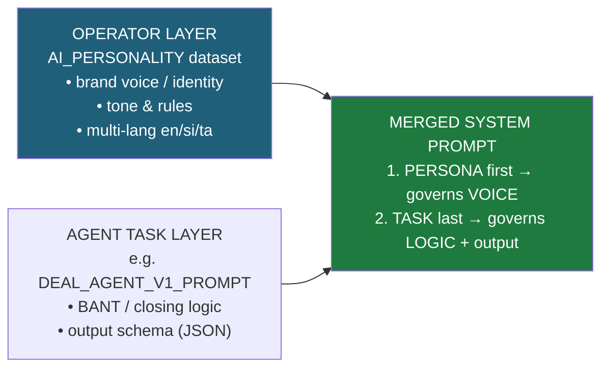
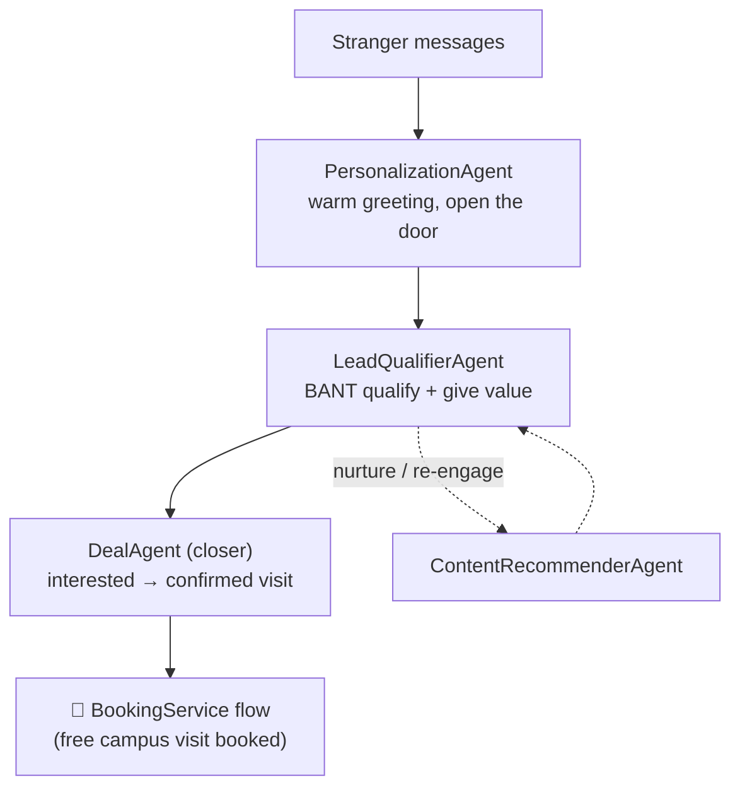

# Marketing & Conversion Flow

How the bot converts a WhatsApp message into a booked customer, and how the
operator's **AI Personality** layer merges into both working types.

> The two "working types":
>
> - **Type A — Live conversation agents** (inbound, real-time): convert a chatting visitor.
> - **Type B — Automation / operator agents** (outbound, background): campaigns, segmentation, follow-up.
>
> After the 2026-06-06 fix, **both customer-facing paths apply your `AI_PERSONALITY`** (Admin Panel → Datasets → AI_PERSONALITY).

---

## 1. Inbound message flow — the two paths

---

## 2. How the two layers merge (`withOperatorPersona`)

The persona shapes the **wording/tone**; the agent still performs its task and
returns its required JSON (task instructions stay last, so they remain salient).

---

## 3. The conversion funnel (Type A agents)

---

## 4. The 5-step conversion playbook (applied on every conversation)

| Step | Name                  | What the bot does                                                      |
| ---- | --------------------- | ---------------------------------------------------------------------- |
| 1    | **CONNECT**           | Greet warmly in the customer's language, mirror tone                   |
| 2    | **UNDERSTAND**        | Ask ONE focused qualifying question (country/job/skills/timeline)      |
| 3    | **VALUE**             | Tie their goal to how you help — sell the outcome, never invent prices |
| 4    | **LOWER THE BARRIER** | Position the FREE, no-obligation campus visit as the next step         |
| 5    | **CALL TO ACTION**    | End with ONE easy CTA ("shall I check available dates?" / `!book`)     |

**Persuasion principles:** reciprocity · risk-reversal · commitment & consistency ·
social proof (only if true) · scarcity (only if true). **Never:** fake urgency,
invented prices/vacancies/testimonials, or pressure.

---

_Source: `src/index.ts`, `src/services/AgentOrchestrator.ts`, `src/agents/*`,
`src/agents/composeSystemPrompt.ts`, `src/config/companies/index.ts`._
